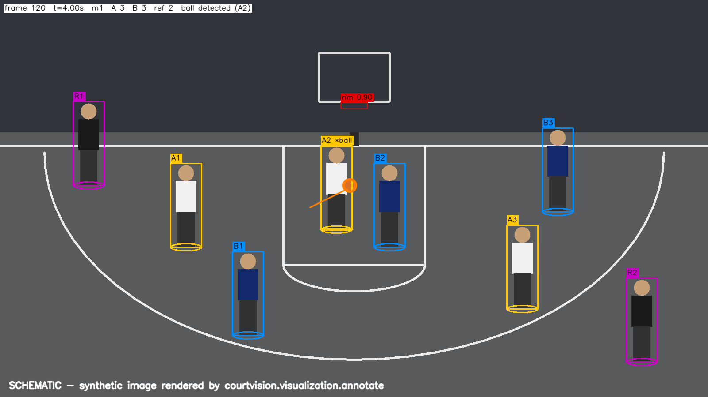
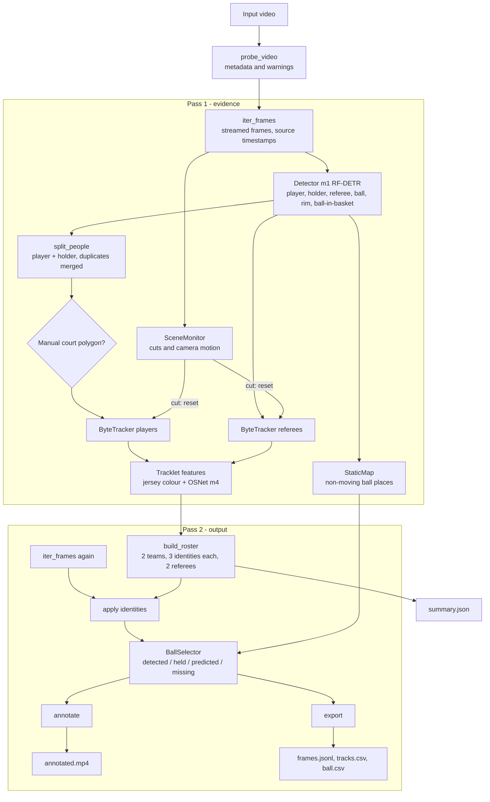
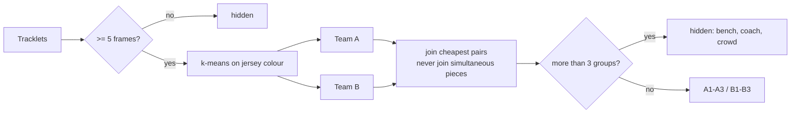
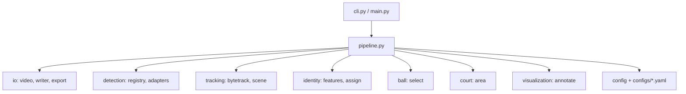
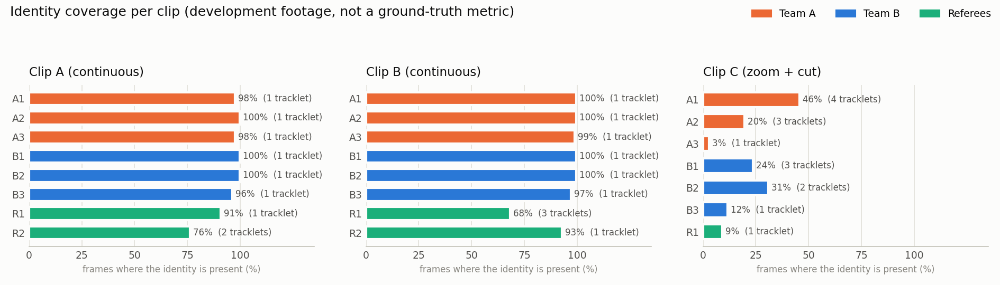
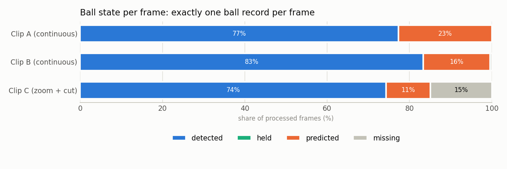
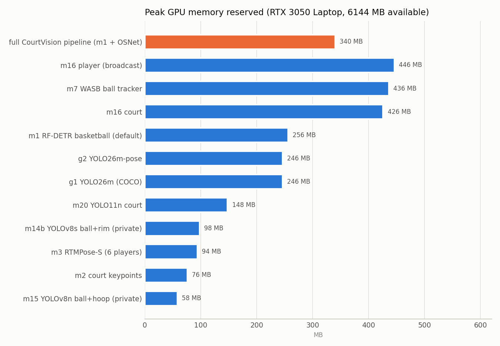

# IIT CourtVision

**A Computer Vision Framework for Single-Camera Basketball Performance Analysis Using Deep Learning and Multi-Object Tracking**

Engineering research project — International Institute of Technology (IIT), Sfax, Tunisia.
This is a student research project; it is not endorsed, supervised or validated by IIT unless stated otherwise.

<p align="center">
  
  <br><em>Output style of the pipeline, shown on a synthetic court (real footage is not published).
  Team A = A1–A3, team B = B1–B3, referees R1–R2, "*ball" = possession, orange circle and line = the single ball and its path.</em>
</p>

> **Status (12 November 2026): work in progress.** Detection, player tracking with a fixed roster, team
> assignment and single-ball tracking run end to end. Shot detection, made/missed classification and court
> mapping are not implemented yet. **No accuracy result has been measured against annotated ground truth yet**;
> the numbers below are pipeline measurements on development clips, not benchmark results.

---

## Contents

1. [Abstract](#1-abstract)
2. [Motivation and problem statement](#2-motivation-and-problem-statement)
3. [Objectives](#3-objectives)
4. [Related work](#4-related-work)
5. [Methodology](#5-methodology)
6. [System architecture](#6-system-architecture)
7. [Models](#7-models)
8. [Datasets](#8-datasets)
9. [Implementation and repository structure](#9-implementation-and-repository-structure)
10. [Experimental setup](#10-experimental-setup)
11. [Preliminary results](#11-preliminary-results)
12. [Limitations](#12-limitations)
13. [Roadmap](#13-roadmap)
14. [Installation and usage](#14-installation-and-usage)
15. [Outputs](#15-outputs)
16. [Reproducibility](#16-reproducibility)
17. [Licence, citation and acknowledgements](#17-licence-citation-and-acknowledgements)
18. [References](#18-references)

---

## 1. Abstract

Amateur and student basketball players rarely have access to the multi-camera tracking systems used in
professional leagues. IIT CourtVision studies how far a **single smartphone on a tripod** can go in producing
objective analytics for **3v3 basketball**: who is on court, where each player moves, who has the ball, and —
in later phases — when shots are taken and whether they are made.

The framework follows a **pretrained-first** strategy: instead of training detectors from scratch, it
inventories, verifies and benchmarks publicly released basketball models, and fine-tunes only where an
evaluation on the target footage shows a gap. The current pipeline combines an RF-DETR basketball detector,
a ByteTrack-style tracker, appearance re-identification (OSNet) and jersey-colour clustering in an
**offline two-pass** design that assigns a **fixed roster** (three players per team and up to two referees)
with stable identities, and selects **exactly one ball per frame** while rejecting static false detections.

On two continuous development clips, each of the six players keeps a single identity in 96–100 % of the
frames. These figures come from broadcast development footage and are not yet a validated benchmark.

**Keywords:** basketball analytics, computer vision, object detection, multi-object tracking,
re-identification, ball tracking, single-camera, sports video analysis.

---

## 2. Motivation and problem statement

Professional systems (multi-camera optical tracking) are expensive and unavailable to university and
amateur teams. A single phone camera is cheap and available, but brings hard problems:

- **Small, fast, often occluded ball**: at 1080p in a wide view the ball covers only ~15–30 pixels and blurs at 30 fps.
- **Identity**: players of the same team wear identical jerseys and occlude each other constantly.
- **Clutter**: spectators, bench players, coaches, officials and ball-like objects appear in the frame.
- **Geometry**: one camera gives no depth; positions on the court need calibration, and the court is often only
  partly visible.
- **Domain gap**: almost all public basketball models and datasets come from NBA-style broadcast footage.

**Problem statement.** Given a single fixed-camera video of a 3v3 game, produce, for every frame, the identity,
team and position of each player and referee, the position and possession of the ball, and (later) the shot
events with their outcome — with honest confidence information wherever the evidence is weak.

---

## 3. Objectives

| # | Objective | Status |
|---|---|---|
| O1 | Inventory and verify open-source basketball models, weights and datasets (licences, hashes, hardware fit) | done (see `MODEL_REGISTRY.md`, `DATASET_REGISTRY.md`) |
| O2 | Detect players, referees, ball and rim | done (pretrained model `m1`) |
| O3 | Track the 6 players with stable identities and split them into two teams | done (development clips) |
| O4 | One ball per frame with possession | done (development clips) |
| O5 | Shot attempt detection and made/missed classification | planned |
| O6 | Court calibration (homography), 2D positions, shot charts, heatmaps | planned |
| O7 | Benchmark on annotated university footage (detection, tracking, shots) | planned |
| O8 | Dashboard and research paper with measured results | planned |

---

## 4. Related work

The research phase reviewed the following public projects and papers (details, licences and verification
status in [`RESEARCH_REPORT.md`](RESEARCH_REPORT.md) and [`MODEL_REGISTRY.md`](MODEL_REGISTRY.md)).

| Work | Relevance | How it is used here |
|---|---|---|
| OpenHoopVision-core (feifeifei85) | Basketball analysis for amateur/youth games; releases an RF-DETR basketball detector, court keypoints, OSNet ReID, jersey OCR | Its **detector checkpoint (`m1`)** and **OSNet encoder (`m4`)** are used through adapters; no code is copied |
| RF-DETR (Roboflow) | Real-time transformer detector, Apache-2.0 | Framework used to run `m1` |
| WASB-SBDT (Tarashima et al., BMVC 2023) | Sports-ball detection and tracking baseline with basketball weights | Downloaded and load-tested; planned ball-tracking comparison |
| ByteTrack (Zhang et al., ECCV 2022) | Two-stage association of high- and low-confidence boxes | Association idea re-implemented independently |
| OSNet / Torchreid (Zhou et al.) | Person re-identification embeddings | Appearance cue for stable identities |
| SportsMOT, TeamTrack, DeepSportradar | Sports tracking and calibration datasets | Context; mostly broadcast domain |
| Roboflow basketball datasets and notebooks | Player/ball/rim/court annotations (CC BY 4.0) | Candidate data for later fine-tuning |
| SwishAI, Swish-Vision, avishah3 shot tracker, shot-tracker, HoopVision, basketball_analysis | Shot counting and broadcast analytics prototypes | Reviewed; unlicensed weights used only for **private** comparison |

Gaps found: no public, licensed model that handles **3x3 courts** for court keypoints (the tested model fails),
no released backboard detector, no released stand-alone shot-event or made/missed model, and no public
benchmark of single-phone amateur 3v3 footage.

---

## 5. Methodology

### 5.1 Pretrained-first strategy

1. Search and **verify** every candidate (repository tree, Git LFS objects, download links, file sizes, SHA-256,
   licence of code / weights / data).
2. Download only shortlisted checkpoints, **scan them for unsafe pickle content** before loading, load-test on
   the target GPU and record parameters and memory.
3. Benchmark candidates on the **same** target footage (Phase 3).
4. Fine-tune a component **only** if the benchmark shows that the best pretrained model is insufficient.

### 5.2 Two-pass offline analysis

Because analysis is offline, the system can look at the whole video before deciding identities.

- **Pass 1 — evidence.** Every frame is detected; players and ball holders are tracked into short, reliable
  *tracklets*; referees are tracked separately; each tracklet accumulates its jersey colour (median CIELAB of the
  torso) and OSNet appearance vectors. Scene cuts and camera motion are measured. Ball sightings feed a map of
  places where a "ball" appears without ever moving.
- **Roster.** Tracklets are split into two teams by weighted k-means on jersey colour. Within each team, pieces
  are joined greedily by the lowest cost — appearance distance + colour distance − motion-continuity bonus —
  under a hard constraint: **two tracklets visible at the same time are never the same person**. The process
  stops at three identities per team (A1–A3, B1–B3) and two referees (R1, R2); the remaining groups (bench,
  coaches, table officials, short false tracks) are hidden and counted.
- **Pass 2 — output.** The video is read again; final identities are applied from the first frame; exactly one
  ball is selected per frame; the annotated video and data files are written.

### 5.3 Single-ball selection

| Rule | Purpose |
|---|---|
| Static-place suppression (camera-motion compensated, learned over the whole video) | removes ball-like objects in the stands |
| Track continuation with a capped search window and capped speed | keeps the ball on its trajectory, prevents jumps |
| A new track may start only near a player or the rim | isolated detections in the crowd are ignored |
| Holder rule: no visible ball but a `holder` detection → ball at the holder's hands | possession when the ball is hidden |
| Prediction for gaps ≤ 0.5 s, otherwise `missing` | explicit uncertainty instead of invented positions |

### 5.4 Scene check

Each video is tested for **scene cuts** (residual difference after camera-shift compensation, or histogram change)
and **camera motion** (phase correlation). The report states whether the fixed-camera assumption holds, because
court calibration is only valid for a static view.

---

## 6. System architecture



Identity decision:



Module dependencies:



Planned extensions (not implemented): shot-event state machine (release → flight → rim interaction →
made / missed / uncertain), homography from manually marked court points, 2D court projection, shot charts,
heatmaps, and a dashboard.

---

## 7. Models

| ID | Model | Task | Source | Licence | Use |
|---|---|---|---|---|---|
| `m1` | RF-DETR Small, basketball (31.8 M params) | detection: player, holder, referee, ball, rim, ball-in-basket | OpenHoopVision-core | Apache-2.0 stated in the source README (no LICENSE file) | **default detector** |
| `m4` | OSNet x1.0, MSMT17 | person re-identification | OpenHoopVision-core / Torchreid | to be verified | **identity appearance cue** |
| `m2` | MobileNetV4 court keypoints (33 points) | court keypoints | OpenHoopVision-core | Apache-2.0 statement | tested: **fails on 3x3 courts**, not used |
| `m3`, `m6` | RTMPose-S, RTMW3D-L | pose (2D, whole-body 3D) | OpenMMLab via OpenHoopVision | to be verified | downloaded, planned for shooting form |
| `m7` | WASB (HRNet) basketball | ball detection/tracking | nttcom/WASB-SBDT | MIT (code) | downloaded, planned comparison |
| `g1` | YOLO26m (COCO) | generic person / sports ball | Ultralytics | AGPL-3.0 | baseline comparison only |
| `m14a/b/c`, `m15` | YOLOv8 ball/rim models | ball, rim | Swish-Vision, avishah3 | **no licence** | **private benchmarking only**, never redistributed |

Checkpoints are **not** stored in this repository. Paths, SHA-256 hashes and licence flags are in
[`configs/models.yaml`](configs/models.yaml); full verification records in [`MODEL_REGISTRY.md`](MODEL_REGISTRY.md)
and [`environment/PHASE1_RECORD.md`](environment/PHASE1_RECORD.md). Unlicensed models only run with
`--allow-private` and their outputs are stamped as private.

---

## 8. Datasets

No dataset has been used for training yet. Candidate public datasets (Roboflow basketball player detection,
court keypoints, "Basketball Shooting Robot", NBA ball dataset, DeepSportradar, SportsMOT) are documented with
sizes, classes and licences in [`DATASET_REGISTRY.md`](DATASET_REGISTRY.md).

The evaluation set will be **our own annotated university footage** (fixed tripod, 3v3), kept private,
never used for training.

Development so far used three short excerpts of a public FIBA 3x3 broadcast. They are **not included** in this
repository (copyright), and no frame of them is published here.

---

## 9. Implementation and repository structure

Python 3.11, PyTorch 2.7 (CUDA 11.8), `rfdetr`, OpenCV, NumPy, SciPy, scikit-learn, imageio-ffmpeg.

```
iit-courtvision/
├── main.py                       python main.py --input VIDEO
├── pyproject.toml                metadata, declared dependencies, pytest settings
├── configs/
│   ├── default.yaml              all run settings (unknown keys rejected)
│   └── models.yaml               model registry: paths, SHA-256, licence flags, class maps
├── courtvision/
│   ├── cli.py, __main__.py       command line: run | inspect | models
│   ├── config.py                 typed, validated configuration + fingerprint
│   ├── paths.py                  data locations (COURTVISION_DATA_ROOT)
│   ├── schemas.py                Detection, BallRecord, FrameRecord (schema v2)
│   ├── pipeline.py               two-pass orchestration, summary report
│   ├── io/                       video.py (probe, stream), writer.py (H.264), export.py (JSONL/CSV/summary)
│   ├── detection/                base.py (class mapping), registry.py (hash + licence guard),
│   │                             rfdetr_adapter.py, ultralytics_adapter.py
│   ├── tracking/                 bytetrack.py (Kalman + Hungarian, two-stage), scene.py (cuts, camera motion)
│   ├── identity/                 features.py (jersey colour, OSNet), assign.py (teams, roster)
│   ├── ball/                     select.py (static map, single-ball selector, rim)
│   ├── court/                    area.py (manual court polygon)
│   └── visualization/            annotate.py
├── scripts/
│   ├── mark_court.py             click the court corners once for a fixed camera
│   ├── compare_models.py         same frames through several detectors, side by side
│   └── make_figures.py           regenerates the README figures from run summaries (no video frames)
├── tests/                        60 tests: unit, synthetic end-to-end, 2 GPU tests
├── docs/PROJECT_GUIDE.md         complete guide: history, architecture, every file, every run
├── docs/images/                  README figures (charts from real runs, synthetic schematic)
├── environment/                  phase records and the reference package list
├── RESEARCH_REPORT.md            research report, licence matrix, benchmark plan, roadmap, risks
├── MODEL_REGISTRY.md             all model candidates and their verification
└── DATASET_REGISTRY.md           all dataset candidates
```

A file-by-file description is in [`docs/PROJECT_GUIDE.md`](docs/PROJECT_GUIDE.md#5-every-file-in-the-repository).

---

## 10. Experimental setup

| Item | Value |
|---|---|
| Hardware | Dell G15 5530 laptop, Intel i5-13450HX, 16 GB RAM, NVIDIA RTX 3050 Laptop GPU 6 GB |
| Software | Windows 11, Python 3.11, PyTorch 2.7.1+cu118, rfdetr 1.12, OpenCV 4.11 |
| Detector input | short side 768 px (1080p frames → 768×1344) |
| Development footage | 3 clips, 1920×1080, 30 fps, 8–10 s, FIBA 3x3 broadcast (private, not published) |
| Target footage (planned) | iPhone on tripod, 1080p 60 fps, 1× lens, rim and key visible |

---

## 11. Preliminary results

**These are pipeline measurements on development footage, not accuracy results.** Identity stability is the share
of processed frames in which an identity is present while built from a single tracklet; it has not been checked
against annotated ground truth.

| Clip (development) | Players per frame (max) | Identity stability | Referees | Ball state |
|---|---|---|---|---|
| Continuous wide shot 1 (295 frames) | 3 + 3 | each player 1 tracklet, 96–100 % of frames | 2 | detected 77 %, predicted 23 % |
| Continuous wide shot 2 (264 frames) | 3 + 3 | each player 1 tracklet, 97–100 % of frames | 2 | detected 83 %, predicted 16 % |
| Zoom + cut clip (249 frames) | 3 + 2 | fragmented | 1 | detected 74 %, missing 15 % |

<p align="center"></p>

On the two continuous clips each player is one unbroken identity for almost the whole clip; on the clip with a
zoom and a camera cut, identities fragment, which is expected because the method assumes a fixed camera.

<p align="center"></p>

Exactly one ball record exists per frame. "Predicted" frames are short gaps bridged by motion; "missing" is
reported instead of inventing a position. The "held" state did not fire on these clips because the detector still
sees the ball in the holder's hands.

<p align="center"></p>

Other measurements:

- GPU memory: peak ≈ 340 MB reserved for the whole pipeline (6 GB available).
- Speed: ≈ 4–5 frames/s end to end; detection ≈ 140 ms per 1080p frame (not optimised).
- Phase 1 load tests: every shortlisted checkpoint fits in under 450 MB of GPU memory.
- Visual inspection of sampled frames: teams correctly separated; IDs on the correct players; bench players and
  spectators not tracked; the ball on the real ball in the sampled frames of the second clip.
- Feasibility finding: the public court keypoint model (`m2`) does not produce valid keypoints on 3x3 courts.

---

## 12. Limitations

- No annotated ground truth yet: no precision, recall, mAP, IDF1 or shot accuracy can be claimed.
- Development footage is broadcast (moving camera, professional floor), not the target fixed phone setup.
- Same-team identity swaps remain possible after long occlusions (identical jerseys); jersey-number reading is
  the next cue.
- Videos with zoom and cuts fragment identities; the method assumes a fixed camera.
- A few short false-ball stretches remain on cluttered broadcast backgrounds.
- The `m1` checkpoint has no stored model configuration; RF-DETR Small defaults are used (as in its source project).
- Single-camera geometry: 3D ball trajectory and physical release angle are not recoverable without extra
  assumptions; any such value will be labelled as an estimate.

---

## 13. Roadmap

| Phase | Content | Status |
|---|---|---|
| 0 | Environment and storage verification | done |
| 1 | Pretrained model registry, download, hash, safety scan, load tests | done |
| 2 | Infrastructure and roster/ball tracking on development clips; university footage and benchmark annotation | infrastructure done; footage pending |
| 3 | Benchmark of shortlisted models on our footage | planned |
| 4 | Model selection and licence route (Apache vs AGPL) | planned |
| 5 | Tracking evaluation (IDF1, ID switches), ball tracking comparison (WASB) | planned |
| 6 | Shot detection and made/missed classification with an `uncertain` state | planned |
| 7 | Court calibration, 2D mapping, shot charts, heatmaps | planned |
| 8 | Integration, speed optimisation, dashboard | planned |
| 9 | Documentation, research paper, publication | in progress |

Fine-tuning is added only for components that fail the Phase 3 benchmark.

---

## 14. Installation and usage

The project is developed in an existing Python 3.11 environment with CUDA PyTorch. In a fresh environment:

```bash
pip install torch==2.7.1 torchvision==0.22.1 --index-url https://download.pytorch.org/whl/cu118
```

```bash
pip install rfdetr opencv-python pyyaml scipy scikit-learn imageio-ffmpeg pytest
```

Model checkpoints are downloaded separately into `<data_root>/checkpoints` (default `C:\IIT_CourtVision_Data`,
override with `COURTVISION_DATA_ROOT`) following [`MODEL_REGISTRY.md`](MODEL_REGISTRY.md); the OSNet encoder
also needs a clone of OpenHoopVision-core in `<data_root>/third_party`.

Run on a video:

```bash
python main.py --input path/to/video.mp4
```

All options:

```bash
python -m courtvision run --input VIDEO --output OUT_DIR --model m1 --stride 2 --max-frames 300
```

Mark the court once for a fixed camera (people outside are then ignored):

```bash
python scripts/mark_court.py --input VIDEO
```

Inspect a video, list models, compare detectors, run tests:

```bash
python -m courtvision inspect VIDEO
```

```bash
python -m courtvision models
```

```bash
python scripts/compare_models.py --input VIDEO --frames 6
```

```bash
python -m pytest
```

---

## 15. Outputs

Each run writes a folder `<data_root>/results/<video>_<model>_<time>/`:

| File | Content |
|---|---|
| `annotated.mp4` | team-coloured boxes with A1–A3 / B1–B3 / R1–R2, possession marker, single ball with trail, scene-cut and private-model badges |
| `frames.jsonl` | one JSON object per frame: `frame_idx`, `t_ms` (source time), scene cut, camera shift, ball record, detections with identity and team |
| `tracks.csv` | identity, team, role, box and foot point per roster member per frame |
| `ball.csv` | ball state (`detected`, `held`, `predicted`, `missing`), position, possession, inferred flag |
| `summary.json` | input metadata and warnings, model and checkpoint hash, configuration and fingerprint, team colours, roster report, ball statistics, scene check, timing, peak GPU memory, package versions, git commit |
| `run.log` | full log |

---

## 16. Reproducibility

- Every run records the **configuration fingerprint**, the **checkpoint SHA-256**, package versions, hardware and
  the **git commit** in `summary.json`.
- Frame indices and timestamps always refer to the source video, also when frames are skipped.
- Checkpoints are verified against recorded SHA-256 hashes before use.
- Third-party code is pinned by commit (`OpenHoopVision-core` `33100c37`, `WASB-SBDT` `923462ca`).
- Phase records in [`environment/`](environment) document every environment change, including the reference
  package list of the development environment.

---

## 17. Licence, citation and acknowledgements

**Licence:** not chosen yet (all rights reserved until a licence file is added). The choice depends on the final
model stack: an Apache-2.0 route (RF-DETR, OpenHoopVision) or an AGPL-3.0 route if Ultralytics models are kept.
Third-party models, code and datasets remain under their own licences; unlicensed models are never redistributed.

**Citation** (preliminary):

```bibtex
@misc{iitcourtvision2026,
  title  = {IIT CourtVision: A Computer Vision Framework for Single-Camera Basketball Performance Analysis
            Using Deep Learning and Multi-Object Tracking},
  author = {Kamel, Aymen},
  year   = {2026},
  note   = {Engineering research project, International Institute of Technology, Sfax. Work in progress},
  url    = {https://github.com/aymen-kamel/iit-courtvision_basketball}
}
```

**Acknowledgements:** OpenHoopVision-core (basketball detector and OSNet encoder), Roboflow RF-DETR,
NTT WASB-SBDT, OpenMMLab RTMPose, Torchreid, and the authors of the public basketball datasets listed in
`DATASET_REGISTRY.md`. Development used Claude Code as an engineering assistant.

---

## 18. References

1. Y. Zhang et al., "ByteTrack: Multi-Object Tracking by Associating Every Detection Box", ECCV 2022. arXiv:2110.06864.
2. S. Tarashima, M. A. Haq, Y. Wang, N. Tagawa, "Widely Applicable Strong Baseline for Sports Ball Detection and Tracking", BMVC 2023. arXiv:2311.05237.
3. K. Zhou, Y. Yang, A. Cavallaro, T. Xiang, "Omni-Scale Feature Learning for Person Re-Identification", ICCV 2019. arXiv:1905.00953.
4. Roboflow, RF-DETR. https://github.com/roboflow/rf-detr
5. OpenHoopVision-core. https://github.com/feifeifei85/OpenHoopVision-core
6. Y. Cui et al., "SportsMOT: A Large Multi-Object Tracking Dataset in Multiple Sports Scenes", ICCV 2023. arXiv:2304.05170.
7. G. Van Zandycke et al., "DeepSportradar-v1: Computer Vision Dataset for Sports Understanding with High Quality Annotations", MMSports 2022. arXiv:2208.08190.
8. A. Maglo et al., "KaliCalib: A Framework for Basketball Court Registration", MMSports 2022. arXiv:2209.07795.
9. T. Jiang et al., "RTMPose: Real-Time Multi-Person Pose Estimation based on MMPose", 2023. arXiv:2303.07399.

Reference details are being verified before they enter the research paper; see `RESEARCH_REPORT.md` §K.
