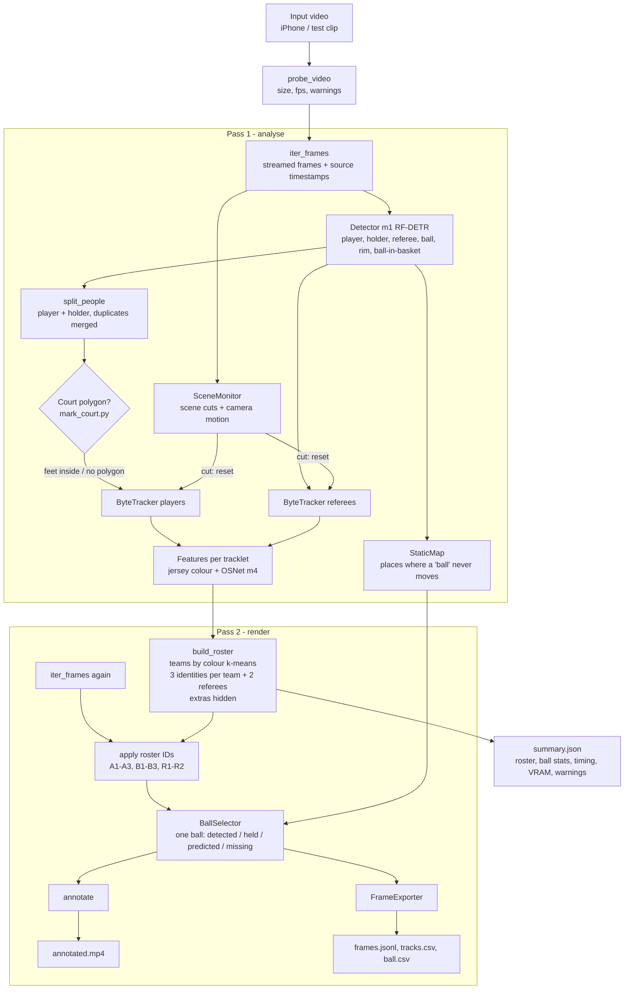
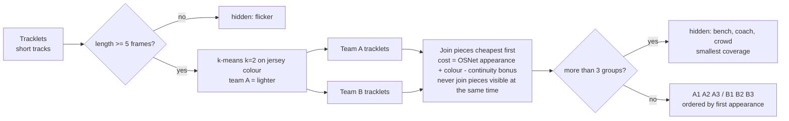
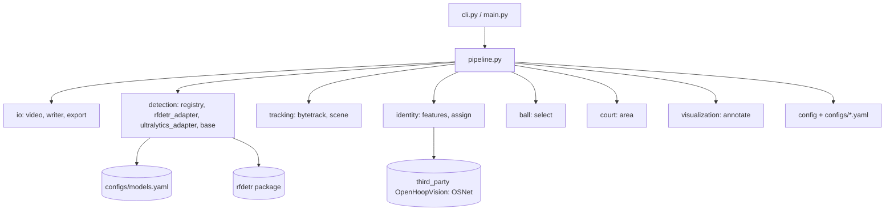

# IIT CourtVision — Complete Project Guide

Last updated: 12 November 2026. This document explains everything done so far, the complete architecture,
every file in the repository, every video and output, and how each part works.

Related documents: `README.md` (quick start), `RESEARCH_REPORT.md` (research and roadmap),
`MODEL_REGISTRY.md` (all models), `DATASET_REGISTRY.md` (all datasets), `environment/*.md` (phase records).

---

## 1. What the project is

IIT CourtVision analyses basketball video from **one camera** (an iPhone on a tripod) and produces:
- the **6 players** of a 3v3 game with **stable IDs** (A1–A3 and B1–B3, one letter per team), and up to **2 referees** (R1, R2);
- **exactly one ball** per frame, with the player who holds it (possession);
- an **annotated video**, per-frame data (`frames.jsonl`), tables (`tracks.csv`, `ball.csv`) and a run report (`summary.json`).

Planned next: shot detection, made/missed classification, court mapping (2D court), statistics, dashboard.

It is an engineering research project at IIT, Sfax. No result has yet been validated against annotated footage.

---

## 2. History: what happened, step by step

| Date | Step | What was done | Key decision / finding |
|---|---|---|---|
| 11 Nov | Research v1 | Read-only audit of the laptop and of open-source basketball projects | Real GPU is an RTX 3050 **6 GB** (not 4 GB); SmartPlay runs in a **venv**, not Conda; bare `python` is a 32-bit 3.10 (never use it) |
| 11 Nov | Research v2 (pretrained-first) | Deep check of 24 candidate models: repo trees, Git LFS, Google Drive, Hugging Face, Roboflow | **OpenHoopVision** (amateur basketball, Apache-2.0 statement) has real downloadable checkpoints; SwishAI has **no** weights; several repos have **no licence** |
| 11 Nov | Phase 0 | Storage and environment check | No external drive → data on `C:\IIT_CourtVision_Data` (outside OneDrive); SmartPlay package list saved as a baseline |
| 11 Nov | Phase 1 | `rfdetr` and `gdown` installed **in the SmartPlay venv** (your choice); 15 checkpoints downloaded, hashed, scanned for unsafe code, load-tested on the GPU | All models fit easily in 6 GB (largest ~450 MB); OpenHoopVision detector = RF-DETR Small; unlicensed models kept in a separate private folder |
| 11 Nov | Test clips | You added 3 clips cut from a FIBA 3x3 broadcast (Serbia–USA) | Used for development only (broadcast copyright, moving camera) |
| 12 Nov | Infrastructure v1 | Repo `C:\dev\iit-courtvision`: video I/O, detector adapters, tracker, scene-cut check, annotated video, exports, 41 tests | Worked end to end, but 10–22 IDs per clip, people outside the court, several balls |
| 12 Nov | Your feedback | "Only the 6 players with IDs that never change, two teams, referees, only one ball, ball in the hand, not in the crowd" | — |
| 12 Nov | Feasibility | Tested the OpenHoopVision court keypoint model `m2` and a colour floor mask | `m2` **fails on 3x3 courts**; colour mask unreliable → you chose roster logic + optional manual court |
| 12 Nov | Infrastructure v2 | Two-pass pipeline: roster (teams, A1–B3, R1–R2) and single-ball selection; 60 tests | Continuous clips: each player keeps **one ID in 96–100 % of frames** |
| 12 Nov | This guide + first commit | — | — |

---

## 3. Machine, environment and storage

| Item | Value |
|---|---|
| Laptop | Dell G15 5530, i5-13450HX, 16 GB RAM, Windows 11 |
| GPU | NVIDIA RTX 3050 Laptop, 6 GB VRAM, CUDA available |
| Python environment | SmartPlay venv `C:\Users\dell\OneDrive\Bureau\pfe\smartplay` — Python 3.11, torch 2.7.1+cu118 |
| Packages added for CourtVision | `rfdetr` 1.12, `transformers` 5.22, `gdown`, `supervision` upgraded 0.27 → 0.31 (all approved; SmartPlay's own 110 tests still pass) |
| Code repository | `C:\dev\iit-courtvision` (outside OneDrive) |
| Large data | `C:\IIT_CourtVision_Data` (outside OneDrive; path configurable with `COURTVISION_DATA_ROOT`) |

The project is **not** pip-installed into the venv. Always run from the repository root with the SmartPlay python:

```bash
C:\Users\dell\OneDrive\Bureau\pfe\smartplay\Scripts\python.exe main.py --input "C:\IIT_CourtVision_Data\raw_videos\Video Project.mp4"
```

### Data folder `C:\IIT_CourtVision_Data`

| Folder | Content |
|---|---|
| `raw_videos\` | input videos (the 3 test clips); a manual court file `<video>.court.json` can sit next to a video |
| `checkpoints\openhoopvision_core\` | `m1` detector, `m2` court, `m3` RTMPose, `m4` OSNet ReID, `m5` jersey OCR |
| `checkpoints\openhoopvision_shooting\` | `m6` RTMW3D whole-body 3D pose |
| `checkpoints\wasb\` | `m7` WASB basketball ball tracker |
| `checkpoints\abdullahtarek\` | `m16` player / "ball" / court models (NBA broadcast) |
| `checkpoints\hf_koppolusameer_court\` | `m20` YOLO11n court keypoints |
| `checkpoints\private_unlicensed\` | `m14a/b/c` (Swish-Vision), `m15` (avishah3): **private benchmarking only, never redistribute** |
| `third_party\OpenHoopVision-core\`, `WASB-SBDT\` | code clones used only to load their models (no code copied into CourtVision) |
| `results\` | one folder per run (see section 7) |
| `logs\` | Phase 1 load-test results |
| `datasets\`, `processed_videos\`, `annotated_videos\`, `training_runs\` | empty, reserved for later phases |

---

## 4. Complete architecture

### 4.1 Pipeline overview



### 4.2 Why two passes

The video is processed **offline**, so the system can look at the whole clip before deciding who is who:
1. **Pass 1** collects short, reliable *tracklets* (pieces of a player's path) and their appearance.
2. The **roster** step joins the pieces into exactly 3 players per team and 2 referees.
3. **Pass 2** reads the video again and draws the final, stable IDs from the very first frame.

The same holds for the ball: places where a false "ball" never moves are learned over the whole video in pass 1,
so they are ignored from frame 0 in pass 2.

### 4.3 How identities are decided



Referees follow the same logic with at most 2 groups (R1, R2). `m1` gives the referee class directly.

### 4.4 How the single ball is chosen (per frame)

1. **Static distractor?** If a "ball" sits at a place where a ball keeps appearing without moving, away from
   players, for at least 1 s, it is ignored (this removed the "ball" in the stands).
2. **Continue the track**: prefer the candidate closest to the predicted position (search window capped).
3. **Restart rule**: a new ball track may only start **near a player or the rim**.
4. **Held ball**: no ball seen but a player is labelled `holder` → ball placed at the holder's hands, possession = that player.
5. **Short gaps** (≤ 0.5 s) are predicted; longer gaps are `missing`.

### 4.5 Module map



---

## 5. Every file in the repository

### Root

| File | What it is / how it works |
|---|---|
| `main.py` | Short entry point: `python main.py --input VIDEO [--output DIR]` = `python -m courtvision run ...` |
| `pyproject.toml` | Project metadata, declared dependencies (not installed by the project), pytest settings |
| `.gitignore` | Keeps videos, weights, datasets, results and logs out of git |
| `README.md` | Quick start, status, commands, outputs |
| `RESEARCH_REPORT.md` | Research report: environment audit, model research, licences, architecture, benchmark plan, roadmap, risks |
| `MODEL_REGISTRY.md` | All 24+ model candidates with checkpoint verification status and Phase 1 measurements |
| `DATASET_REGISTRY.md` | All datasets found, sizes, licences, suitability |
| `docs/PROJECT_GUIDE.md` | This document |

### `configs/`

| File | What it is |
|---|---|
| `default.yaml` | Every run setting: video stride, detector size and thresholds, tracker, scene-cut, court, identity (roster), ball, output. Unknown keys are rejected |
| `models.yaml` | Model registry: id → backend, checkpoint path, SHA-256, licence flag, class mapping to the standard classes |

### `courtvision/` (the package)

| File | Responsibility | Main functions / classes |
|---|---|---|
| `__init__.py`, `__main__.py` | Version; `python -m courtvision` | — |
| `cli.py` | Command line: `run`, `inspect`, `models` | `main()` |
| `config.py` | Loads and validates `default.yaml` into typed settings; config fingerprint for reproducibility | `load_config`, `RunConfig`, `ConfigError` |
| `paths.py` | Locations of data, checkpoints, results, third-party code | `data_root()` |
| `schemas.py` | Shared records: `Detection` (box, class, track id, identity, team), `BallRecord`, `FrameRecord` | — |
| `logging_setup.py` | Console + `run.log` logging | `setup_logging` |
| `pipeline.py` | The two-pass orchestration described in section 4; writes `summary.json` | `run_pipeline`, `split_people` |
| `io/video.py` | Reads video metadata and warnings (fps < 60, resolution < 1080p…); streams frames with **source** timestamps | `probe_video`, `iter_frames` |
| `io/writer.py` | Writes H.264 MP4 through the ffmpeg bundled with imageio-ffmpeg (mp4v fallback) | `VideoSink` |
| `io/export.py` | Writes `frames.jsonl`, `tracks.csv`, `ball.csv`, `summary.json` | `FrameExporter`, `write_summary` |
| `detection/base.py` | Standard classes, class-name mapping, per-class thresholds, detector input size | `ClassMapper`, `input_shape` |
| `detection/registry.py` | Reads `models.yaml`, checks the file exists and its SHA-256, **refuses unlicensed models without `--allow-private`**, builds the right adapter | `load_registry`, `build_detector` |
| `detection/rfdetr_adapter.py` | Runs RF-DETR checkpoints (model `m1`) with the official `rfdetr` package | `RFDETRDetector` |
| `detection/ultralytics_adapter.py` | Runs YOLO checkpoints (COCO baseline `g1`, comparison models); imports AGPL code only when used | `UltralyticsDetector` |
| `tracking/bytetrack.py` | Own implementation of the ByteTrack idea: Kalman filter + Hungarian matching, confident boxes first, low-confidence boxes rescue tracks | `ByteTracker`, `iou_matrix` |
| `tracking/scene.py` | Detects scene cuts (difference after camera-shift compensation, or histogram change) and measures camera motion; reports whether the camera is really fixed | `SceneMonitor` |
| `court/area.py` | Manual court polygon: load/save `<video>.court.json`, "feet inside the court?" test | `CourtArea`, `find_court_area` |
| `identity/features.py` | Jersey colour (median Lab colour of the torso) and OSNet appearance vectors (model `m4`, loaded from the OpenHoopVision clone) | `jersey_colour`, `OSNetEmbedder` |
| `identity/assign.py` | Tracklets → two teams → A1–A3, B1–B3, R1–R2; never joins pieces visible at the same time; hides extras | `Tracklet`, `split_teams`, `group_tracklets`, `build_roster` |
| `ball/select.py` | One ball per frame (section 4.4) and one rim per frame | `StaticMap`, `BallSelector`, `select_rim` |
| `visualization/annotate.py` | Draws team-coloured boxes with IDs, possession, the single ball with a short trail, the court outline, header and badges | `annotate` |

### `scripts/`

| File | Use |
|---|---|
| `mark_court.py` | Opens a frame; you click the court corners; saves `<video>.court.json`. For the **fixed** university camera |
| `compare_models.py` | Puts the same frames through several detectors side by side (visual comparison only, not a benchmark) |

### `tests/` (60 tests, `python -m pytest`)

| File | What is tested |
|---|---|
| `conftest.py` | Synthetic test video generator and a fake detector |
| `test_config_schemas.py` | Config validation and the record formats |
| `test_video_io.py` | Metadata, timestamps, stride, H.264 writer, exports |
| `test_detection.py` | Class mapping, input sizes, licence guard, hash checks, registry |
| `test_tracking.py` | Tracker (crossing players, occlusion, expiry, reset), scene cut and pan detection |
| `test_identity.py` | Jersey colour, team split, no joining of simultaneous pieces, broken tracks rejoined, caps of 3 per team and 2 referees |
| `test_ball_court.py` | Static ball suppression, moving ball never static, one ball, restart rule, held ball, gaps, court polygon |
| `test_pipeline.py` | End-to-end on a synthetic video, court filter, stride, CLI, and two GPU tests (real detector, OSNet) |

### `environment/`

| File | Content |
|---|---|
| `PHASE0_RECORD.md` | Storage and environment check |
| `PHASE1_RECORD.md` | Package changes, every checkpoint with size, SHA-256, scan and load-test results |
| `PHASE2_PREP_RECORD.md` | Infrastructure v1 and v2 results on the test clips, findings, remaining errors |
| `smartplay_baseline_freeze.txt` | SmartPlay package list before any change (rollback reference) |

---

## 6. The videos

### 6.1 Input clips (`C:\IIT_CourtVision_Data\raw_videos`)

All three: cut by you from a FIBA 3x3 World Cup broadcast (Serbia vs USA, Vienna), re-exported with Clipchamp,
1920×1080, 30 fps, H.264. **Private test material** (broadcast copyright): never published.

| Clip | Length | Content | Camera check |
|---|---|---|---|
| `Video Project.mp4` | 9.8 s, 295 frames | Continuous wide shot, start of the game (score 0–0) | fixed |
| `Video Project  1.mp4` | 8.8 s, 264 frames | Continuous wide shot, score 4–5 | fixed (small pan) |
| `Video Project  1 (1).mp4` | 8.3 s, 249 frames | Low angle, then the camera zooms onto the rim (a made basket), then a cut to a close side angle | **not fixed**: zoom in 60 % of frames, one cut at frame 231 |

### 6.2 Output runs (`C:\IIT_CourtVision_Data\results`)

Each folder name is `<clip>_<model>_<date-time>`. Every folder has `annotated.mp4`, `frames.jsonl`,
`tracks.csv`, `summary.json`, `run.log` (and `ball.csv` from version 2).

| Run time (12 Nov) | Version | What it shows |
|---|---|---|
| 11:41–11:43 | v1 | First infrastructure: every detection drawn, IDs `#1…#22`, no teams, several balls |
| 11:44–11:46 | v1.1 | Holders tracked together with players |
| 12:11–12:13 | v2 first run | Roster A1–B3, R1–R2 and single ball; the stand "ball" still chosen sometimes |
| 12:17–12:19 | v2.1 | Static places learned over the whole video, restart near players/rim |
| **12:22–12:24** | **v2.2 (current)** | Capped search window and speed, trail broken on jumps — **the videos to look at** |
| `compare_Video_Project_20261112-114756` | comparison | 3 frames × 6 models side by side (`m1`, `g1`, `m16_player`, `m14a`, `m14b`, `m15`) |

Older run folders can be deleted by hand; they are kept only to show the progress.

### 6.3 Current results (v2.2)

| Clip | Players per frame | Identity stability | Referees | Ball |
|---|---|---|---|---|
| Video Project | 3 + 3 | each player one ID in 96–100 % of frames | 2 | detected 77 %, predicted 23 % |
| Video Project 1 | 3 + 3 | each player one ID in 97–100 % of frames | 2 | detected 83 %, predicted 16 % |
| Video Project 1 (1) | 3 + 2 | fragmented (zoom + cut) | 1 | detected 74 %, missing 15 % |

### 6.4 What you see in an annotated video

- Yellow boxes **A1–A3** = team A (lighter jersey, here Serbia white); blue boxes **B1–B3** = team B (USA blue).
- Magenta **R1, R2** = referees.
- `*ball` after an ID = this player has the ball.
- Orange circle = the ball (double circle = inferred position: held or predicted), orange line = its last 0.5 s.
- Small red box = the rim. Header: frame, time, model, number of A/B/referees, ball state and owner.
- "SCENE CUT" when the camera cuts; "PRIVATE MODEL" when an unlicensed model was used.

---

## 7. Output files in detail

| File | Format |
|---|---|
| `frames.jsonl` | One JSON per processed frame: `frame_idx`, `t_ms` (source time), `scene_cut`, `camera_shift_px`, `ball` {state, xy, conf, possession, inferred}, `detections` [{cls, conf, xyxy, track_id, identity, team}] |
| `tracks.csv` | `frame_idx, t_ms, identity, team, role, track_id, conf, x1, y1, x2, y2, foot_x, foot_y` (foot = bottom-centre of the box, where the player stands) |
| `ball.csv` | `frame_idx, t_ms, state, x, y, conf, possession, inferred` |
| `summary.json` | Input metadata and warnings, model + checkpoint hash, full config + fingerprint, court area, team colours, roster report (frames, coverage, tracklets per identity, hidden), max per frame, ball statistics, scene check, timing, peak VRAM, package versions, git commit |
| `run.log` | Console log of the run |

---

## 8. How to use

```bash
python main.py --input "C:\IIT_CourtVision_Data\raw_videos\Video Project.mp4"
```

```bash
python -m courtvision run --input VIDEO --output OUT_DIR --model m1 --stride 2 --max-frames 300
```

```bash
python scripts/mark_court.py --input VIDEO
```

```bash
python -m courtvision inspect VIDEO
```

```bash
python -m courtvision models
```

```bash
python scripts/compare_models.py --input VIDEO --frames 6 --allow-private
```

```bash
python -m pytest
```

Recommended recording for the university footage: tripod, elevated side or 45° view, rim and key fully visible,
1080p **60 fps**, 1× lens, clips of a few minutes. Then run `mark_court.py` once per camera position.

---

## 9. Models and licences in use

| Model | Role | Licence | Status |
|---|---|---|---|
| `m1` OpenHoopVision RF-DETR Small | detector (default) | Apache-2.0 stated in README (no LICENSE file) | used |
| `m4` OSNet x1.0 MSMT17 | player appearance for stable IDs | to verify (research weights) | used |
| `g1` YOLO26m (COCO) | baseline / comparison | AGPL-3.0 | comparison only |
| `m14a/b/c`, `m15` | comparison | **no licence** | private only (`--allow-private`) |
| `m2` court keypoints | court mapping | Apache-2.0 statement | **fails on 3x3 courts**, not used |
| RF-DETR package | detector framework | Apache-2.0 | used |

The repository licence is still to be chosen (Apache route vs AGPL route), before any publication.

---

## 10. Known limits and next steps

Known limits (not hidden):
- Tested only on broadcast clips; no accuracy number yet (needs annotated university footage).
- Identity swaps between two players of the same team are still possible after long occlusions; jersey-number
  reading (`m5`) is the next lever.
- The zoom/replay clip keeps fragmented identities (a fixed tripod avoids this).
- A few short false ball stretches remain (e.g. above the rim in "Video Project", frames 275–294).
- `m1` checkpoint has no stored model config; `rfdetr` falls back to RF-DETR Small defaults (same as OpenHoopVision's own loader).
- Speed ≈ 4–5 frames/s on this laptop (detection ≈ 140 ms per frame); not optimised yet.

Next steps (roadmap):
1. Record university footage (fixed tripod) and annotate a small benchmark set.
2. Phase 3: benchmark the shortlisted models on it (detection, ball, tracking, ID switches).
3. Shot detection and made/missed classification (trajectory + rim + `ball-in-basket` + uncertain state).
4. Court mapping for a fixed camera (manual points → homography → 2D court), shot charts, heatmaps.
5. Speed optimisation, dashboard, research paper with measured results, GitHub publication (after approval).
